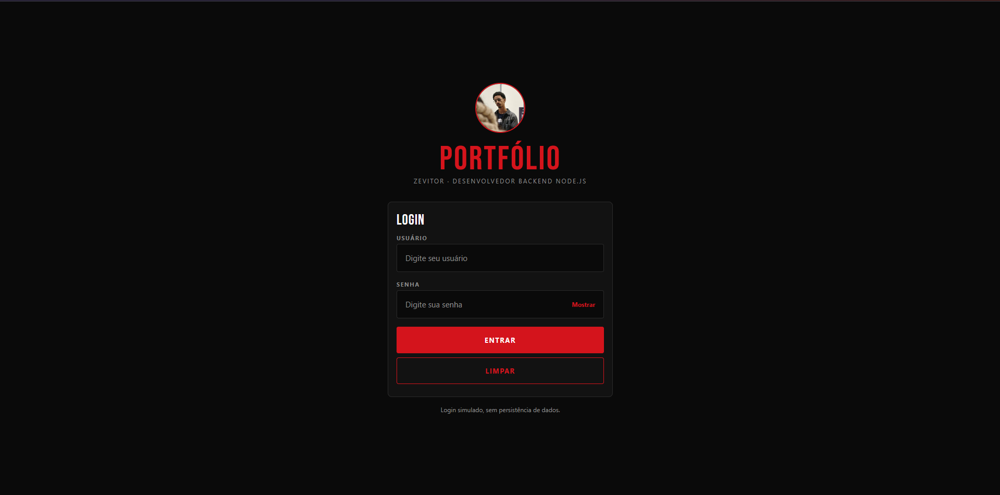
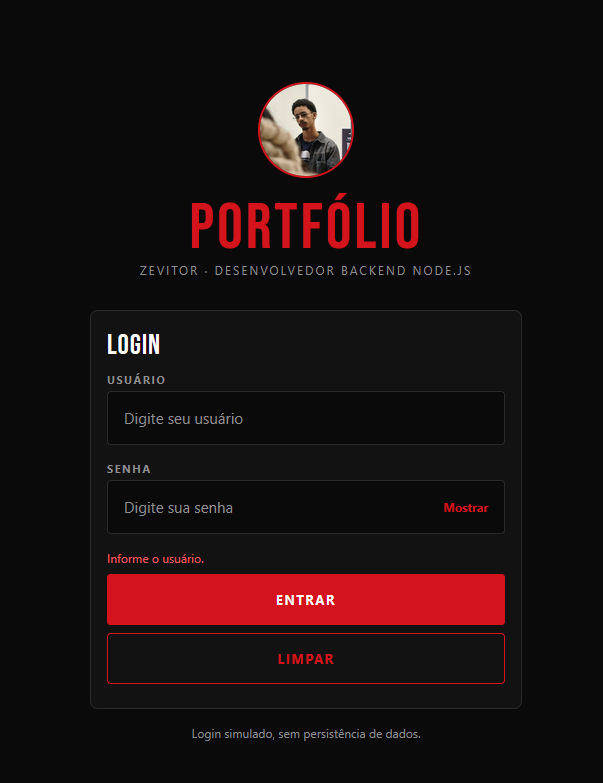
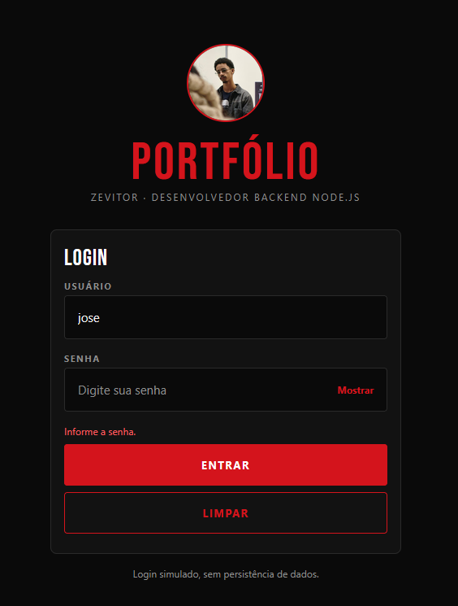
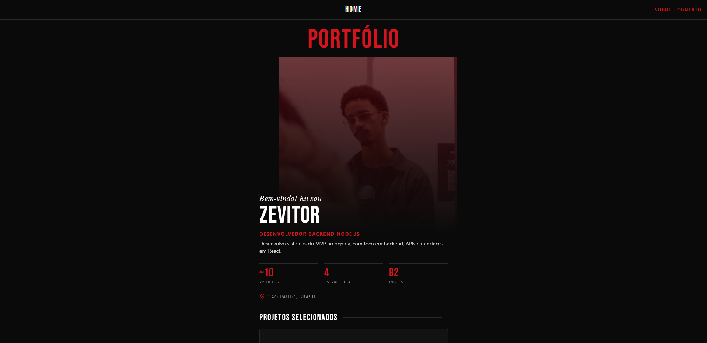
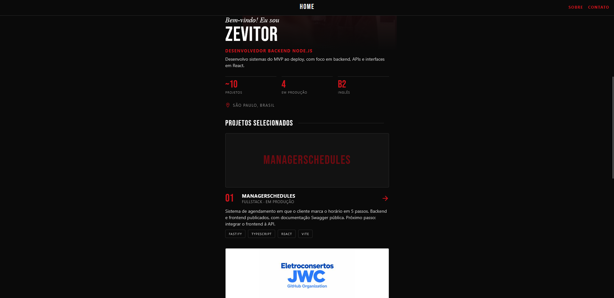
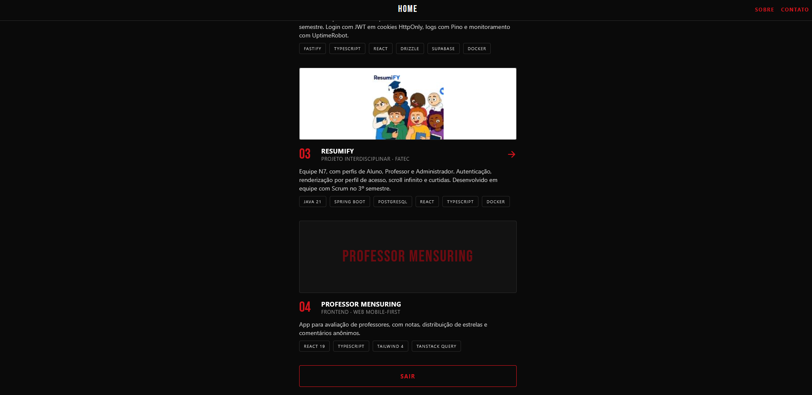
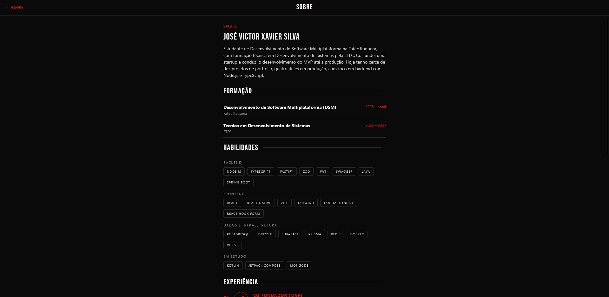
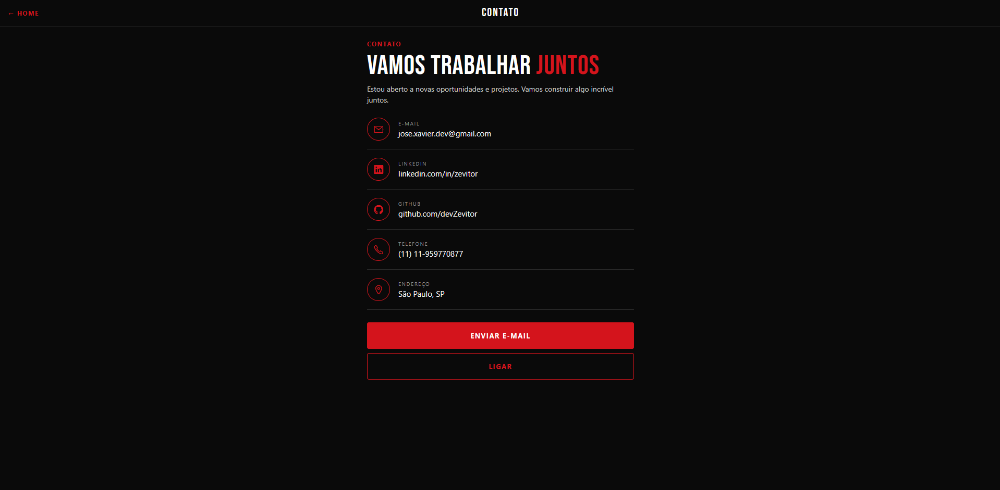

# Portfólio Zevitor

**Aluno:** José Victor Xavier Silva  
**Aplicação:** Portfólio Zevitor

## Descrição

O Portfólio Zevitor é um protótipo mobile de portfólio pessoal para um desenvolvedor de software, em tema escuro com detalhes em vermelho. A aplicação demonstra um login simulado e a navegação entre as telas Home, Sobre e Contato, apresentando projetos, formação, habilidades, experiência e canais de contato. Foi desenvolvida para a disciplina de Programação para Dispositivos Móveis I.

## Uso de Inteligência Artificial

Foi utilizada a IA como apoio durante o desenvolvimento do projeto, nas seguintes atividades:

- **Estrutura inicial do projeto:** geração da base do aplicativo em React Native com Expo (telas, navegação, Toolbar, componentes e estilos), posteriormente adaptada e personalizada por mim.
- **Organização dos dados em JSON:** estruturação das informações do portfólio (formação, experiência, habilidades e projetos) no arquivo `src/data/profile.js`.
- **Commits do GitHub:** criação das mensagens de commit.
- **Apoio durante o processo:** dúvidas sobre configuração do ambiente (Node, Docker e Expo), resolução de erros e elaboração do README.

A revisão, os ajustes finais e a validação do funcionamento da aplicação foram feitos por mim.

## Tecnologia/framework

- React Native
- Expo SDK 58
- JavaScript
- React Navigation (native stack)
- `StyleSheet` para estilização
- Docker (imagem `node:22-slim`) para execução do ambiente

A aplicação é voltada para Android e também pode ser aberta no navegador para testes.

## Como executar

**Execução com Docker:** requer o Docker Desktop. O compose usa a imagem `node:22-slim`, compatível com o Expo SDK 58.

1. Copie `.env.example` para `.env` e troque `HOST_IP` pelo IPv4 do computador na rede Wi-Fi (`ipconfig` no Windows).
2. Execute na pasta do projeto:

```bash
docker compose up
```

3. No celular Android (mesma rede Wi-Fi), abra o Expo Go e escaneie o QR code exibido no terminal. No computador, o app também abre em http://localhost:8081.

Para ver alterações no código, execute `docker compose restart` e recarregue o app. Se o firewall do Windows bloquear a conexão, permita a porta 8081 para redes privadas.

**Execução local:** com Node.js 22 ou superior e npm instalados, execute na pasta do projeto:

```bash
npm install
npx expo start
```

Escaneie o QR code com o Expo Go no Android, ou pressione `a` para abrir no emulador Android e `w` para abrir no navegador.

## Credenciais para teste

- **Usuário:** `jose`
- **Senha:** `jose123`

As credenciais estão definidas em `src/config/credentials.js`. O login é apenas demonstrativo; não utiliza autenticação externa nem armazena credenciais de forma persistente.

## Estrutura resumida dos diretórios

```text
meu-portfolio/
├── App.js
├── index.js
├── app.json
├── package.json
├── docker-compose.yml
├── .env.example
├── assets/          # Foto e imagens dos projetos
├── docs/
│   └── capturas/    # Capturas de tela do README
└── src/
    ├── components/ # Componentes reutilizáveis e Toolbar
    ├── config/     # Credenciais de demonstração
    ├── data/       # Dados do portfólio (profile.js)
    ├── navigation/ # Navegação entre telas
    ├── pages/      # Login, Home, Sobre e Contato
    └── styles/     # Cores, tipografia e estilos
```

## Funcionalidades implementadas

- Login com validação de campos vazios e credenciais inválidas.
- Campo de senha com caracteres ocultos e botão Mostrar/Ocultar.
- Botão para limpar os campos do login.
- Navegação entre Login, Home, Sobre e Contato, com retorno à Home.
- Toolbar com título por tela, links de navegação e retorno à Home.
- Home com apresentação, indicadores e lista de projetos selecionados.
- Tela Sobre com formação, habilidades e experiência.
- Tela Contato com links para e-mail, LinkedIn, GitHub e telefone, além de botões para enviar e-mail e ligar.
- Componentes reutilizáveis (Button, Input, Toolbar, Tag, ProjectCard, SectionHeader e IconCircle) e estilos centralizados com StyleSheet.
- Uso de imagens locais e ícones vetoriais.
- Conteúdo do portfólio centralizado em `src/data/profile.js`.

## Capturas de tela

### Login
<p align="center">
  
</p>
<p align="center">
  
</p>
<p align="center">
  
</p>

### Home
<p align="center">
  
</p>
<p align="center">
  
</p>
<p align="center">
  
</p>

### Sobre
<p align="center">
  
</p>

### Contato
<p align="center">
  
</p>